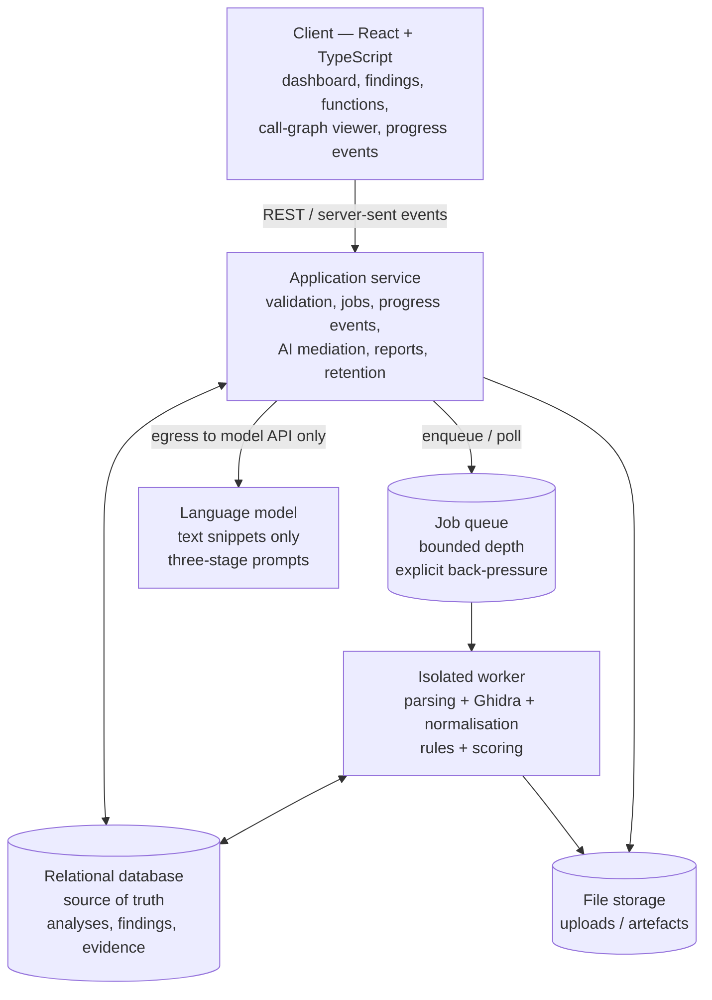
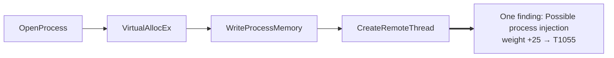

# AI-Assisted Static Reverse Engineering: Proposed Methodology for Evidence-First Triage of Portable Executable Binaries

> HISTORICAL PROPOSAL: Current product behavior is governed by `docs/SPEC.md` Amendment 1.5. This methodology predates arbitrary-file ingestion, automatic AI tool use, and evidence-based verdicts.

*Academic submission — System design, modules, and algorithms*

**Name:** ____________________ | **Roll No.:** __________ | **Course:** __________
**Institution:** ____________________ | **Date:** __________

---

## Abstract

Understanding an unfamiliar binary without executing it remains labour-intensive: analysts must reconcile headers, sections, imports, strings, disassembly, and decompiled pseudocode, while distinguishing benign uses of sensitive APIs from genuinely suspicious behaviour. Large language models (LLMs) can summarise code fluently but, unconstrained, hallucinate behaviours and techniques. This document presents the proposed methodology for an AI-assisted static reverse engineering platform. The platform converts a Windows Portable Executable (PE) binary into structured metadata, recovered functions, a call graph, deterministic behavioural findings, evidence-grounded natural-language explanations, a reproducible risk score, qualified MITRE ATT&CK annotations, and a downloadable Markdown report. Every significant claim is traceable from the dashboard to the underlying evidence (function, import, string, or section). A deterministic core (rule-based detection, correlation, scoring, confidence, and ATT&CK candidacy) produces all verifiable claims, and a bounded three-stage LLM layer contributes only interpretation grounded to explicit evidence identifiers. The design degrades honestly: decompilation or model failures yield explicitly labelled partial results rather than silent gaps. Evaluation is defined over a small owned-source corpus of benign and synthetic binaries with precision, recall, ATT&CK identification accuracy, grounding validity, and score reproducibility as acceptance metrics.

**Keywords:** static analysis, reverse engineering, Ghidra, LIEF, call graph, rule-based detection, MITRE ATT&CK, explainable AI, evidence grounding.

---

## Contents

1. Introduction
2. Problem Statement, Objectives, and Scope
3. Design Principles
4. System Architecture
5. Methodology and Module Description
6. Algorithms
7. Evaluation Methodology
8. Failure Handling, Limitations, and Ethics
9. Conclusion and Future Work
- References
- Appendix A — Glossary

---

## 1. Introduction

Reverse engineering seeks to recover intent from machine code: what a program does, which capabilities it exercises, and which behaviours merit closer inspection. For students and junior analysts the barrier is scale rather than theory — a modest executable may contain thousands of functions, and naively reading disassembly does not scale. Existing tooling is fragmented: parsers expose headers and imports, disassemblers recover control flow, hand-written rules flag suspicious API combinations, and language models summarise code, but no single chain links a high-level claim back to the exact bytes that justify it.

The methodology proposed here unifies these layers into one traceable workflow: upload a binary, obtain immediate static metadata, recover functions and the call graph asynchronously, apply deterministic behavioural rules with call-graph-aware correlation, compute a reproducible risk score with a per-finding weight breakdown, qualify MITRE ATT&CK techniques against minimum-evidence gates, and generate bounded, evidence-cited natural-language explanations. The system operates without executing the sample and without requiring the language model: static facts, rule findings, and the report remain available when the model is disabled or its budget is exhausted.

---

## 2. Problem Statement, Objectives, and Scope

### 2.1 Problem statement

Given a single untrusted Windows PE binary (64-bit primary; 32-bit and ELF as natural extensions), produce within minutes: (i) reliable file identity and structural metadata; (ii) recovered functions with decompiled excerpts and a call graph; (iii) a ranked set of behavioural findings, each supported by at least one inspectable evidence item; (iv) a deterministic risk score with an auditable derivation; (v) qualified ATT&CK technique annotations; and (vi) a human-readable report that preserves uncertainty. The solution must resist adversarial content embedded in the binary (e.g., instructional text planted in strings to mislead the language model), must never present a heuristic score as a malware verdict, and must explicitly label incomplete analysis.

### 2.2 Objectives

- **O1 — Reduce time to understanding:** surface the five most significant findings, their evidence, and the risk derivation without requiring exhaustive manual reading.
- **O2 — Guarantee traceability:** every finding links to concrete evidence rows (function address, import record, string offset, or section entry) with excerpts and provenance.
- **O3 — Ensure reproducibility:** identical normalised evidence and component versions yield identical deterministic outputs (findings, score, severity, confidence, ATT&CK candidates).
- **O4 — Explain without inventing:** restrict the language model to interpretation (purpose, behaviour narrative, uncertainty, benign alternative, rationale) and forbid it from emitting scores, severities, or confidences.
- **O5 — Fail honestly:** distinguish completed, partial, and failed analyses; label decompilation timeouts and model unavailability in the interface and the report.

### 2.3 Scope and delimitations

The work addresses static analysis only. Dynamic execution, sandboxing, kernel tracing, malware-family attribution, binary patching, and forensic-grade verdicts are explicitly out of scope. Initial coverage targets 64-bit Windows executables and dynamic libraries; 32-bit and ELF support follow the same design with architecture-specific adjustments, while uncommon architectures are processed on a best-effort basis with a degraded-quality label. Unsupported formats (e.g., Mach-O, scripts, archives) are rejected with a clear diagnostic. No live malware is used at any stage; evaluation relies exclusively on benign utilities and purpose-built synthetic samples compiled from owned source.

---

## 3. Design Principles

| Principle | Interpretation in this work |
|---|---|
| Evidence first | No finding exists without cited evidence; the interface deep-links each citation to its source row or graph node. |
| Deterministic core, interpretive shell | Rules, correlation, scoring, confidence, and ATT&CK candidacy are pure versioned functions. The LLM explains but never decides. |
| Honest partial results | Expensive stages (decompilation, language model) may fail; the system retains and labels whatever is verified. |
| Zero trust in the sample | The binary is never executed; paths are randomised; sizes are capped before parsing; decompiled text is treated as untrusted data. |
| Bounded language-model use | Only top-ranked functions are summarised; character, token, call-count, and rate budgets are enforced; outputs are schema-validated and identifier-checked. |
| Local reproducibility | Containerised services, a relational database as the source of truth, content-hash caching, and pinned component versions. |

---

## 4. System Architecture

A stateless web client communicates with an application service over REST and server-sent events. The application service owns request validation, job management, progress streaming, language-model mediation, report generation, and data retention. A message broker queues analysis jobs; a relational database persists all queryable state; an isolated worker performs parsing, decompilation, normalisation, and deterministic detection. File storage separates raw uploads from derived artefacts. Only the application service may contact the external language-model endpoint, and only with extracted text fragments — the raw binary is never transmitted.



**Figure 1. Complete system architecture.** The worker has no outbound network access; the application service is the sole language-model egress. Uploads, artefacts, and database volumes are isolated.

### 4.1 Service responsibilities

| Component | Responsibility | Representative technology |
|---|---|---|
| Web client | Dashboard, findings, functions, focused call graph, report view; progress banners | React, TypeScript, Cytoscape |
| Application service | Validation, job lifecycle, progress events, AI mediation, scoring assembly, reports, retention | Python web framework |
| Job queue | Durable work distribution; bounded depth with explicit back-pressure response | Redis-backed task queue |
| Database (truth) | Analyses, sections, imports, strings, functions, edges, signals, findings, evidence | PostgreSQL |
| Worker | Header parsing, string/entropy analysis, Ghidra orchestration, normalisation, rules | LIEF, Ghidra headless, Capstone (helper) |
| Language model | Bounded structured summarisation and correlation; text only | OpenAI-compatible HTTP interface |

### 4.2 Deployment and isolation

Services are containerised with three logical networks: a client-facing network between the interface and the application service; an internal-only network between the application service, worker, queue, and database; and a dedicated egress path from the application service to the configured language-model endpoint, guarded by an application-level allow-list and deployment firewall rules. The worker mounts no host paths, runs unprivileged with a read-only root filesystem where practical, and writes only to a per-job scratch directory. Uploads are size-capped at ingress and at the application layer (100 MB default), stored under random identifiers with restrictive permissions, and removed on deletion or after a time-to-live expiry (24 hours default).

---

## 5. Methodology and Module Description

The workflow is decomposed into eight modules with narrow interfaces.


**Figure 2. Staged static-analysis pipeline.** Order is fixed: cheap verified facts precede expensive recovery; deterministic detection precedes interpretation. Decompilation failure degrades to a static-only partial result; model failure degrades to a rule-only partial result.

### 5.1 Module 1 — Intake, validation, and orchestration

This module is the security boundary. It enforces layered size limits (proxy limit, application byte counting over the request stream with early abort, and bounded temporary storage so forged length headers cannot exhaust disk), rejects empty inputs, sniffs magic bytes at offset zero (MZ for PE, ELF magic otherwise) rather than trusting extensions or MIME types, and records extension mismatches as advisory warnings. Each accepted upload creates a new analysis identifier even when its hash duplicates a prior submission, preserving provenance while linking prior identifiers for reference. A finite-state job machine (created, validating, static analysis, reverse-engineering analysis, normalising, detection, AI analysis, reporting, with terminal states completed, partial, failed, cancelled) drives progress reporting over server-sent events with heartbeats, reconnection identifiers, and a polling fallback. Cancellation revokes queued work and terminates any running decompiler process group before cleanup. A scheduled reconciler reaps expired analyses and orphaned directories.

### 5.2 Module 2 — Static extraction

Static extraction produces immediate, model-free facts: cryptographic hashes (SHA-256, MD5), file size, format, architecture, bitness, endianness, entry point, section table (name, virtual address, virtual and raw sizes, permissions, per-section entropy), import and export tables (library, symbol, ordinal, address, functional category), certificate metadata where present, and recovered strings. Strings cover printable ASCII sequences and UTF-16LE sequences of length four or more, each with file offset, encoding, length, and a coarse category (path, URL, registry, command, other). Full string rows are retained in the database subject to a per-analysis cap; only truncated excerpts are eligible for language-model context. Failure to parse headers terminates the analysis as failed without invoking the decompiler.

### 5.3 Module 3 — Control-flow recovery (Ghidra automation)

This module recovers functions, assembly excerpts, decompiled pseudocode, cross-references, and call edges using Ghidra in headless mode, driven by a small Java export script. Each job runs in a fresh project directory with the input copied under a fixed name (never the user-supplied filename), a bounded per-file analysis budget inside a larger outer watchdog (on the order of thirteen versus fifteen minutes, giving the tool a shutdown window), captured logs with a size cap, and guaranteed scratch-project deletion on success, failure, or cancellation. Concurrency is fixed at one decompilation per worker process to bound memory (8 GB ceiling). A per-function failure marks that function only and the job continues. Import and section truth remains with static extraction; the decompiler is authoritative solely for functions, assembly, decompilation, and edges.

### 5.4 Module 4 — Normalisation and storage

Normalisation converts heterogeneous tool outputs into a single versioned canonical document (schema version 1.0) with stable identifiers (function identity combines the analysis identifier with the lowercase hexadecimal address), deterministic ordering (sections and imports by address, functions by address, strings by offset), import deduplication, and strict null conventions. The canonical document is validated before any downstream use; a validation failure is treated as an internal defect, not as a property of the sample. Persisted state separates queryable rows (relational tables for sections, imports, strings, functions, edges, signals, findings, evidence, technique mappings, and model runs, with cascading deletes) from file artefacts (canonical JSON, per-function full decompilation files, truncated tool logs, cached reports). Full decompilation retrieval validates the function identifier, confirms ownership by the enclosing analysis, confines the resolved path beneath the analysis artefact directory, and caps rendered output.

### 5.5 Module 5 — Deterministic behavioural detection

Detection combines twenty declarative indicators with six call-graph-aware correlation groups. Each indicator declares a category, severity, numeric weight, candidate ATT&CK technique, triggering APIs, characteristic strings, optional regular expressions, and an optional Python detector for relational logic (multi-signal requirements, call proximity). Simple indicators match on API, string, or expression presence; complex detectors evaluate signal sets against the normalised model and the call graph. Correlation groups merge related signals — for example, process-open, memory-allocate/write, and remote-thread signals in the same or nearby functions merge into a single process-injection finding — and absorb their constituents so weights are never double-counted. When grouping fails, constituents survive as weak standalone signals.



**Figure 3. Correlation over the call graph.** Nearby weak signals (same function or undirected call-distance ≤ 3) combine into one behaviour finding; grouping absorbs constituents.

| Group | Required signals | Result (weight → technique) |
|---|---|---|
| Injection | ≥2 of open/allocation-write/thread incl. allocation or thread; same function or ≤3 hops | Possible process injection, +25 → T1055 |
| Registry persistence | Registry open/create plus value-set; Run-key string elevates confidence | Registry persistence, +15 → T1547.001 |
| Download-and-write | ≥2 of network, HTTP, file-write; file-write required for high confidence | Ingress-tool-transfer, +15 → T1105 |
| Service / scheduled task | Service-manager plus service creation, or two scheduler signals | System-service / scheduled-task, +15 → T1543 / T1053 |
| Input capture | Hook API plus message/input API, or a strong hook with supporting behaviour | Input capture, +20 → T1056 |
| Anti-analysis | ≥2 of debugger, VM/sandbox, timing checks on one path (capped combined weight) | Evasion, capped +12 → T1497 |

### 5.6 Module 6 — Risk scoring, confidence, and ATT&CK qualification

Risk scoring is a closed-form, model-independent function: the sum of weights of non-absorbed findings, capped at 100, mapped to bands (0–30 Low, 31–60 Medium, 61–80 High, 81–100 Critical) with a per-finding contribution table. Ordering is deterministic (weight descending, identifier ascending) and the derivation inputs (evidence hash plus scoring, rule, prompt, and schema versions) are stored so any score can be re-derived.

Worked example: `+25` (process injection) + `+15` (registry persistence) + `+5` (HTTP API) + `+3` (temp-file write) = **48/100, Medium**. Each bar below is one finding contribution; the method and versions accompany every score. The score is heuristic, not a verdict.

Confidence is likewise deterministic: a lone signal yields Low; a multi-signal condition in one function yields Medium; multi-signal plus call-chain plus string or contextual corroboration yields High, with numeric sub-scores in fixed intervals (Low 0.20–0.49, Medium 0.50–0.79, High 0.80–1.00). ATT&CK candidacy is rule-generated against fifteen curated techniques with minimum-evidence gates; the language model may only argue for downgrading a candidate with a rationale, never for upgrading it or inventing techniques outside the list. Low-confidence mappings are retained diagnostically but hidden from the primary view, and technique wording uses qualified terms (Possible, Likely) rather than confirmation.

### 5.7 Module 7 — Bounded language-model explanation

The language model contributes readability, not verdicts. Processing has three stages: (1) per-function summarisation (purpose in one to two sentences, behaviour list, evidence-bound indicators, mandatory uncertainty statement, benign alternative); (2) behaviour correlation over the ranked summaries, rule hits, and local graph neighbourhood (behaviour narratives with cited evidence and affected-function identifiers, without re-ingesting raw decompilation); (3) report synthesis (executive summary, key behaviours, limitations, model-availability note) that preserves uncertainty verbatim and introduces no new techniques.

Function selection is deterministic: signals are normalised to a common interval and combined with fixed weights (rule hits weighted most, then suspicious-API density, graph centrality, entry reachability, string support, and a scaled size term) with address tie-breaking; the default budget covers fifty functions, automatically reduced to twenty under token pressure. Character, token, call-count, and per-minute budgets are enforced with a real tokenizer before every request; assembly is truncated before decompilation tails, and evidence identifiers and import names are never truncated. Responses must satisfy strict JSON schemas that forbid severity, confidence, and score fields; identifier existence is checked against the enclosing analysis with at most two automated repairs before the fragment is discarded and the analysis continues as rule-only.

Prompt-injection defences include evidence delimiters, a system instruction that evidence is data rather than instructions, escaping and normalisation of untrusted text, temperature zero, provenance hashes per model run, and logging of suspicious instructional patterns without relying on block-lists. Model use is consent-gated: without explicit consent (and, for hosted models, an API key) the pipeline runs fully deterministically.

### 5.8 Module 8 — Visualisation and reporting

The interface follows progressive disclosure: what matters now, why, and then evidence on demand. Seven views cover uploading, an overview (file identity, risk with expandable derivation, top findings, counts, versions, status banners), a searchable cursor-paginated function table, a function detail view (bounded excerpt with opt-in full retrieval, collapsible assembly, import/string references, and a three-part explanation block separating deterministic observation from model interpretation and from the benign alternative), a findings view of full cards with evidence chips that deep-link to their sources, a focused call-graph view, and a report view.

The graph renders a server-truncated breadth-first neighbourhood (default focus with depth two, node and edge caps) with centrality-ordered retention, distinct styling for internal, imported, and entry nodes, dashed styling for possible-indirect edges that are static approximations, explicit truncation notices, an offline export, and a keyboard-navigable neighbour table as an accessible alternative. The visual language avoids ornament and pseudo-precision: flat severity badges, non-numeric confidence badges, monospace evidence chips, and small risk figures that are meaningless without their breakdown.

The Markdown report mirrors the interface — executive summary, file identity, score derivation, per-finding observation/interpretation/alternative/evidence/technique, technique summary, summarised functions, structural highlights, limitations, and full provenance — and introduces no claims beyond what the interface shows.

---

## 6. Algorithms

### 6.1 Per-section Shannon entropy (packing indicator)

For each section, the empirical byte distribution over its raw bytes yields entropy H in bits per byte (0–8). Sections at or above 7.5 bits that additionally exhibit abnormal permissions (e.g., writable and executable), a large discrepancy between virtual and raw sizes, or missing symbols are reported as possibly packed or obfuscated — a heuristic prompt for caution, never standalone proof, and only a low-weight contribution unless corroborated.

```text
H(section) = - SUM_b freq(b) * log2(freq(b))
flag if H >= 7.5 AND (RWX OR |vsize - raw| large OR symbols absent)
```

### 6.2 Function ranking for the language-model budget

Each heterogeneous signal is first normalised to the unit interval (centrality already in [0,1]; rule-hit and suspicious-API counts via min(count/5, 1); entry reachability as 0/1 via breadth-first search from the entry point over direct edges; string support similarly; size via a clipped log ratio). A fixed-weight sum prioritises rule evidence, then API density, centrality, reachability, string support, and size; ties break by address. The top K functions (fifty by default, twenty under budget pressure) proceed to summarisation. Weights are fixed and the procedure is evaluated against held-out corpus behaviour before any tuning.

```text
score(f) = 3*hits(f) + 2*apis(f) + centrality(f) + reachable(f) + strings(f) + size(f)
order by (-score, address); take K
```

### 6.3 Graph centrality (PageRank over the direct-call subgraph)

Centrality is computed in the worker before ingestion using PageRank (damping 0.85) over the directed graph of direct calls only; possible-indirect edges are excluded from ranking and from distance measurement to avoid asserting precision the static approximation cannot support. Scores are normalised to [0,1] and subsequently used both for language-model ranking and for prioritising which graph neighbours survive server-side truncation.

### 6.4 Correlation distance and group decision

Call distance is the shortest undirected path length between the functions containing two signals, measured over direct edges. Each correlation group specifies its required signal multiset and distance bound (for example, injection requires at least two of the three signal types including an allocation or thread signal, in one function or within three hops). A satisfied group emits one behaviour finding with its full weight and marks constituents absorbed; an unsatisfied group leaves weak standalone signals. When one API could support two groups, a fixed priority (injection, then download, persistence, input capture, anti-analysis) awards it to the first group.

### 6.5 Risk scoring and confidence mapping

```text
active = { h : h not absorbed }
score  = min(100, SUM weight(h))
Low <= 30 < Medium <= 60 < High <= 80 < Critical
```

Confidence follows coverage: one signal maps to Low (0.20–0.49); a satisfied multi-signal condition in one function maps to Medium (0.50–0.79); the addition of a call chain and string or contextual corroboration maps to High (0.80–1.00). Technique confidence inherits the same scale from the generating rule and can only be qualified downward by the language model.

### 6.6 Model-output grounding and repair

Every structured model response is checked for forbidden keys (severity, confidence, score), for citation of only evidence and function identifiers belonging to the enclosing analysis, and for address validity. A violation triggers a repair prompt (remove forbidden keys, retain identifiers, cite only listed identifiers) at most twice; persistent failure discards the model fragment, retains the deterministic findings, records a grounding-failure model run, and marks model status degraded. Token usage, input hashes, and model and prompt versions are logged per run for audit.

---

## 7. Evaluation Methodology

### 7.1 Corpus

Evaluation uses nine owned-source binaries compiled specifically for this work; no live or third-party malware is included. Four benign utilities exercise ordinary capabilities (minimal executable, file creation and writing without persistence, an HTTP retrieval without persistence or injection, and a minimal ELF control). Five synthetic samples each isolate one behaviour of interest: registry Run-key persistence; process creation with network use; URL download with file writing; co-located open-process, allocation, write, and remote-thread calls; and combined debugger, timing, and virtualisation checks. Sources, build notes, hashes, and expected outcomes are recorded in a corpus manifest kept outside version control as a private artefact.

| Class | Samples | Intent |
|---|---|---|
| Benign (4) | Minimal PE; file utility; network utility; minimal ELF | Confirm no High-severity findings without evidence |
| Synthetic (5) | Registry persistence; process+network; download+write; injection pattern; anti-debug/VM | Confirm each behaviour is detected with the expected rule and technique |

### 7.2 Metrics and acceptance thresholds

Expected rule and technique outcomes are authored jointly from source inspection. Reported metrics are per-indicator precision and recall, exact-identifier ATT&CK accuracy, the grounding failure rate (invalid citations after repair divided by total citations), and score reproducibility under re-execution with identical inputs and versions. Prototype acceptance thresholds are set at precision and recall of at least 90% on synthetic samples, ATT&CK accuracy of at least 85%, grounding failures below 2%, and no High-severity finding on benign samples without supporting evidence. Trimmed canonical documents without full decompilation serve as regression reference snapshots; any change to tooling, normalisation, rules, scoring, or prompts triggers the full corpus re-run with human-approved re-baselining.

| Synthetic behaviour | Precision (target) | Recall (target) |
|---|---|---|
| Registry persistence | 100% | 100% |
| Process + network | 100% | 100% |
| Download + write | 100% | 100% |
| Injection pattern | 100% | 100% |
| Anti-debug / VM | ≥90% | ≥90% |

*Illustrative presentation of per-behaviour results against the 90% acceptance reference. Owned-source synthetic binaries only; benign utilities produced no High-severity findings.*

### 7.3 Testing strategy

- **Unit tests:** header parsing fixtures, entropy computation, multi-signal rule logic, double-count guards, strict schema rejection, and cursor pagination.
- **Integration tests (model mocked):** end-to-end upload-to-report flows, decompiler execution on the minimal sample, database cascade deletion, event-stream reconnection and terminal events, and cancellation and timeout process-tree cleanup with orphan-process assertions.
- **Security tests:** malformed and truncated inputs with fuzzing, path-traversal rejection, oversize-upload streaming with flat memory, large-input timeout behaviour yielding partial results, and prompt-injection fixtures verifying that embedded instructions are never followed.
- **End-to-end runs:** the full nine-sample corpus with reference-snapshot comparison and final validation.

---

## 8. Failure Handling, Limitations, and Ethics

| Situation | System response | What the reader sees |
|---|---|---|
| Oversize / empty / wrong format | Rejected before job creation | Plain-language diagnostic with the size or format requirement |
| Header parsing failure | Terminal failure, no decompilation attempted | Invalid-binary explanation |
| Decompiler timeout or crash | Partial result: verified static facts and static-only findings retained | Partial banner naming the decompilation timeout |
| Single-function recovery failure | Function marked failed; remainder unaffected | Degraded-function badge |
| Model timeout, rate limit, or budget exhaustion | Partial result: deterministic findings and rule-only report retained | Model-unavailable notice with reduced-scope indicator |
| Invalid or hallucinated model citation | Fragment discarded after bounded repair; deterministic output retained | Partial-model notice; audit log entry |
| Infrastructure outage / full queue | Job held or refused with retry guidance | Service or back-pressure message with retry interval |
| Deletion or expiry | Database cascade plus artefact-directory removal | Deletion confirmation |

Limitations follow directly from the static-only commitment: packing and obfuscation, stripped symbols, indirect control flow, and deliberate anti-analysis degrade recall, and the absence of indicators must never be read as proof of benignity — a statement repeated in the interface, the findings view, and the report. The risk score is a transparent heuristic sum, not a verdict, and technique labels are qualified possibilities with stated evidence. Ethically, the platform analyses only user-supplied or owned-source binaries, transmits no binary content to external services, discloses that decompiled output may incidentally contain embedded secrets, and gates any hosted-model use behind explicit consent. Offensive capabilities, automated countermeasure deployment, and family attribution are excluded by design.

---

## 9. Conclusion and Future Work

The proposed methodology makes static triage both faster and more accountable: inexpensive verified facts arrive immediately, expensive recovery proceeds asynchronously, deterministic correlation and scoring produce auditable claims, and a tightly bounded language model renders those claims legible without acquiring any authority over them. The traceability invariant — from risk breakdown to finding to technique to function to evidence excerpt — is the central contribution, alongside the honest-partial-results discipline that treats timeouts and model outages as first-class outcomes rather than edge cases.

Natural extensions, deliberately excluded from the present scope, include YARA-suggestion workflows, embedding-based similarity search, conversational investigation, multi-user access control, paginated-document export, consent-managed hosted deployment, and, under a separate threat model, dynamic analysis. Each can attach to the canonical normalised representation without disturbing the deterministic core established here.

---

## References

1. National Security Agency — Ghidra software reverse engineering framework (headless analysis and scripting API).
2. LIEF project — Library to Instrument Executable Formats (PE/ELF parsing).
3. Capstone engine — Lightweight multi-architecture disassembly framework.
4. MITRE Corporation — ATT&CK knowledge base: enterprise techniques referenced (T1055, T1053, T1543, T1547.001, T1105, T1071.001/.004, T1082, T1057, T1012, T1003, T1056, T1497, T1027, T1127, T1218).
5. PostgreSQL documentation — Relational storage, JSONB, advisory locks.
6. React and Cytoscape.js documentation — Interface and graph visualisation.
7. OpenAI-compatible API conventions — Structured-output HTTP interface for language-model mediation.
8. Shannon, C. E. — A mathematical theory of communication (entropy).
9. Page, Brin, et al. — The PageRank citation-ranking formulation (centrality).

---

## Appendix A — Glossary

| Term | Meaning |
|---|---|
| PE / ELF | Windows Portable Executable / Executable and Linkable Format (Linux/Unix) |
| RVA / file offset | Relative virtual address once loaded / byte position in the file |
| Call distance | Shortest undirected path length between signal-bearing functions over direct call edges |
| Grounding | Validation that every cited evidence or function identifier exists in the enclosing analysis |
| Input hash | SHA-256 over the sorted evidence set plus component versions; the reproducibility key |
| Partial result | Verified subset retained and labelled after a non-fatal stage failure |
| Top-K | Deterministically ranked function shortlist admitted to language-model summarisation |
